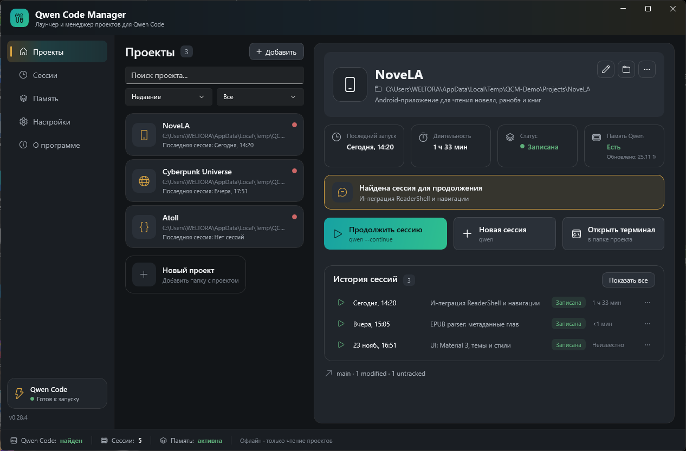

# Qwen Code Manager

**English** · [Русский](README.ru.md)

[](https://github.com/weltora/qwen-code-manager/releases)
[](LICENSE)


A dark, modern desktop **launcher and project/session manager for [Qwen Code](https://github.com/QwenLM/qwen-code)**.
It orchestrates the real Qwen Code CLI — it is **not** an IDE, terminal, Git client or AI agent.

Open the manager, pick a project, and instantly see: what the project is, when the last Qwen session ran,
what you were working on, what changed in Git — and continue with one click.



## Features

- **Command center for your projects** — list with search, sort (recent / name / status / Git activity) and type filters (Android / Web / .NET / …)
- **Continue / New session** — launches the real `qwen` in the project directory: `qwen -c` to continue, `qwen -r <id>` to resume a specific session, plain `qwen` for a new one (Windows Terminal preferred)
- **Session history** — read-only discovery from `%QWEN_HOME%\projects\<slug>\chats\` with dates, duration estimates, titles and live-process detection
- **Read-only Git status** — branch, modified / staged / untracked counts, ahead/behind; GitHub remote detection with *Open GitHub*
- **Project detection** — name and type from Gradle, package.json, csproj/sln, Cargo, README and more
- **Covers** — your image → project image → cached GitHub preview → procedural placeholder; fully offline-capable
- **Checkpoints** — a plain `.qwen-manager/checkpoint.md` you own; created only on explicit request
- **Qwen memory visibility** — read-only view of `QWEN_HOME`, `QWEN.md`, installed Skills
- **Offline-first** — everything except optional GitHub cover lookup works without internet
- **Safe by design** — never modifies your projects, Qwen config, `.env`, keys or skills; no secrets stored; Git operations are read-only

More screenshots: [session detail](docs/screenshots/project-detail.png) · [sessions](docs/screenshots/sessions.png) · [memory](docs/screenshots/memory.png)

## Install

Download **`QwenCodeManager-Setup-x64.exe`** from [Releases](https://github.com/weltora/qwen-code-manager/releases) and run it.

- Installs to `C:\Program Files\Qwen Code Manager`, adds a Start Menu shortcut
- Upgrades in place; uninstall via **Settings → Apps**
- Your data lives separately in `%LOCALAPPDATA%\QwenCodeManager\` and is **never removed** by the installer/uninstaller
- Qwen Code itself is **not** bundled — the manager auto-detects your existing installation (`qwen.cmd`)
- Self-contained: no .NET runtime installation required

> The installer is currently unsigned; Windows SmartScreen may show a warning. Code signing is planned for production releases.

## Build from source

Requires [.NET SDK 8](https://dotnet.microsoft.com/download/dotnet/8.0) (pinned via `global.json`).
The Windows SDK comes from NuGet (`Microsoft.Windows.SDK.BuildTools`) — no Visual Studio workload needed.

```powershell
dotnet build -c Release
dotnet test          # 51 unit tests
dotnet publish src\QwenCodeManager.App -c Release -r win-x64 --self-contained true -o artifacts\publish\win-x64
```

Build the installer (requires [Inno Setup 6](https://jrsoftware.org/isinfo.php)):

```powershell
powershell -ExecutionPolicy Bypass -File build-installer.ps1
# → artifacts\installer\QwenCodeManager-Setup-x64.exe (+ .sha256, version.json)
```

See [INSTALLER.md](INSTALLER.md) and [RELEASE.md](RELEASE.md) for details.

## Architecture

```
src/QwenCodeManager.Core           UI-independent services + models (net8.0-windows)
  Services/    Project, Qwen, Session, Git, Cover, Checkpoint, Settings
  Infrastructure/  AppPaths, ProcessRunner, FileLogger, atomic JSON store
src/QwenCodeManager.App            WinUI 3 / Windows App SDK 1.7, MVVM (CommunityToolkit.Mvvm)
tests/QwenCodeManager.Core.Tests   xUnit
installer/                         Inno Setup script
tools/                             icon generator, demo-screenshot sandbox
```

### Qwen integration facts (verified against 0.28.x)

- Executable resolution honors `PATHEXT` and skips the extensionless POSIX `qwen` sh shim; batch files run through `cmd.exe`.
- Project slug: absolute path lowercased, `:` `\` `/` → `-` (e.g. `c--users-x-desktop-app`).
- Session files: `<id>.jsonl` (transcript), `<id>.runtime.json` (snake_case: `started_at`, `work_dir`, `qwen_version`), `<id>.title.json`.
- Session status is honest: *Active* (live pid), *Recorded* (transcript exists), *Metadata only* — Qwen does not store a "completed" flag.

## License

[MIT](LICENSE)
