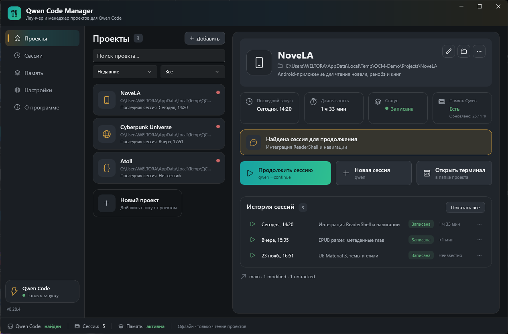

# Qwen Code Manager

[English](README.md) · **Русский**

[](https://github.com/weltora/qwen-code-manager/releases)
[](LICENSE)


Тёмный современный настольный **лаунчер и менеджер проектов/сессий для [Qwen Code](https://github.com/QwenLM/qwen-code)**.
Он оркестрирует настоящий Qwen Code CLI — это **не** IDE, терминал, Git-клиент и не AI-агент.

Откройте менеджер, выберите проект и сразу увидите: что это за проект, когда была последняя сессия Qwen,
над чем вы работали, что изменилось в Git — и продолжите работу одним кликом.



## Возможности

- **Командный центр проектов** — список с поиском, сортировкой (недавние / имя / статус / Git-активность) и фильтрами по типу (Android / Web / .NET / …)
- **Продолжить / Новая сессия** — запускает настоящий `qwen` в директории проекта: `qwen -c` для продолжения, `qwen -r <id>` для конкретной сессии, просто `qwen` для новой (предпочитается Windows Terminal)
- **История сессий** — read-only обнаружение из `%QWEN_HOME%\projects\<slug>\chats\`: даты, оценка длительности, названия, определение живого процесса
- **Read-only Git-статус** — ветка, изменённые / staged / untracked файлы, ahead/behind; определение GitHub-remote и кнопка «Открыть GitHub»
- **Определение проектов** — имя и тип из Gradle, package.json, csproj/sln, Cargo, README и других
- **Обложки** — ваша картинка → изображение проекта → кешированный GitHub-preview → процедурный placeholder; работает офлайн
- **Checkpoint** — обычный файл `.qwen-manager/checkpoint.md`, которым владеете вы; создаётся только по явному запросу
- **Память Qwen** — read-only просмотр `QWEN_HOME`, `QWEN.md`, установленных Skills
- **Offline-first** — всё, кроме опциональной загрузки обложек GitHub, работает без интернета
- **Безопасность** — никогда не изменяет ваши проекты, конфигурацию Qwen, `.env`, ключи и skills; секреты не хранятся; Git — только чтение

Ещё скриншоты: [детали проекта](docs/screenshots/project-detail.png) · [сессии](docs/screenshots/sessions.png) · [память](docs/screenshots/memory.png)

## Установка

Скачайте **`QwenCodeManager-Setup-x64.exe`** из [Releases](https://github.com/weltora/qwen-code-manager/releases) и запустите.

- Установка в `C:\Program Files\Qwen Code Manager`, ярлык в меню «Пуск»
- Обновление поверх старой версии; удаление через **Параметры → Приложения**
- Ваши данные хранятся отдельно в `%LOCALAPPDATA%\QwenCodeManager\` и **никогда не удаляются** установщиком
- Qwen Code **не входит** в поставку — менеджер сам найдёт вашу установку (`qwen.cmd`)
- Self-contained: установка .NET runtime не требуется

> Установщик пока не подписан; Windows SmartScreen может показать предупреждение. Подпись кода планируется для production-релизов.

## Сборка из исходников

Требуется [.NET SDK 8](https://dotnet.microsoft.com/download/dotnet/8.0) (пинован в `global.json`).
Windows SDK берётся из NuGet (`Microsoft.Windows.SDK.BuildTools`) — рабочие нагрузки Visual Studio не нужны.

```powershell
dotnet build -c Release
dotnet test          # 51 unit-тест
dotnet publish src\QwenCodeManager.App -c Release -r win-x64 --self-contained true -o artifacts\publish\win-x64
```

Сборка установщика (нужен [Inno Setup 6](https://jrsoftware.org/isinfo.php)):

```powershell
powershell -ExecutionPolicy Bypass -File build-installer.ps1
# → artifacts\installer\QwenCodeManager-Setup-x64.exe (+ .sha256, version.json)
```

Подробности: [INSTALLER.md](INSTALLER.md) и [RELEASE.md](RELEASE.md).

## Архитектура

```
src/QwenCodeManager.Core           UI-независимые сервисы и модели (net8.0-windows)
  Services/    Project, Qwen, Session, Git, Cover, Checkpoint, Settings
  Infrastructure/  AppPaths, ProcessRunner, FileLogger, атомарное JSON-хранилище
src/QwenCodeManager.App            WinUI 3 / Windows App SDK 1.7, MVVM (CommunityToolkit.Mvvm)
tests/QwenCodeManager.Core.Tests   xUnit
installer/                         скрипт Inno Setup
tools/                             генератор иконки, песочница демо-скриншотов
```

### Факты интеграции с Qwen (проверено на 0.28.x)

- Поиск исполняемого файла учитывает `PATHEXT` и пропускает POSIX sh-shim `qwen` без расширения; batch-файлы запускаются через `cmd.exe`.
- Slug проекта: абсолютный путь в нижнем регистре, `:` `\` `/` → `-` (например `c--users-x-desktop-app`).
- Файлы сессий: `<id>.jsonl` (транскрипт), `<id>.runtime.json` (snake_case: `started_at`, `work_dir`, `qwen_version`), `<id>.title.json`.
- Статусы сессий честные: «Активна» (живой pid), «Записана» (есть транскрипт), «Только метаданные» — Qwen не хранит флаг «завершено».

## Лицензия

[MIT](LICENSE)
